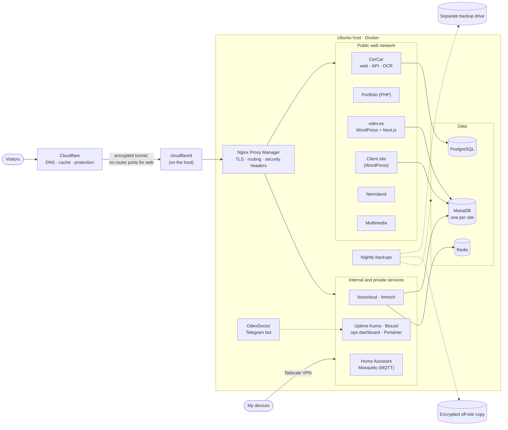

# Homelab showcase

Public, recruiter-friendly overview of the **self-hosted server I design, run and fix myself** — where my own products, a client website, my files and photos, and the home automation live.

> Architecture only: no IPs, tokens, firewall rules, internal ports or private hostnames.

**Full narrative (ES/EN):** [portfolio.odev.es/lab](https://portfolio.odev.es/lab) · *Resumen en español al final.*

---

## At a glance

| | |
|---|---|
| **Hardware** | Intel N100 · 4 cores · 16 GB · Ubuntu 24.04 LTS |
| **Workload** | About 55 Docker containers, one Compose project per service |
| **Way in** | Cloudflare Tunnel → Nginx Proxy Manager (TLS) → containers |
| **Private access** | Tailscale VPN only (admin panels are never on the internet) |
| **Backups** | Nightly databases + configs, a second copy on a separate drive, encrypted off-site copies |
| **Operations** | Own Telegram bot (OdevDoctor), Uptime Kuma, Beszel, a private ops dashboard |

---

## Architecture

Visitors reach Cloudflare, which provides DNS, cache and protection. An encrypted Cloudflare Tunnel brings the traffic to the server **without opening any router port for the websites**. Nginx Proxy Manager terminates TLS and sends each domain to its container. Admin panels only open through my VPN (Tailscale), over HTTPS. At home, a small CoreDNS instance lets the TV and phones talk to the server directly instead of looping out through the internet.

---

## Layers

### Web and products

| Site | What it is |
|------|-----------|
| [cercar.es](https://cercar.es) | **CerCar**, my own product in public beta: vehicle history, maintenance, car events and fleets. TypeScript (Next.js + NestJS), its own PostgreSQL and automatic invoice reading with OCR (runs locally, no external AI). |
| [portfolio.odev.es](https://portfolio.odev.es) | This portfolio (PHP). |
| [odev.es](https://odev.es) | My web studio, Odev Studio (WordPress, custom theme). The link page [odev.es/oscar](https://odev.es/oscar) is a separate Next.js app; the proxy routes by path. |
| [dunia-lobera.odev.es](https://dunia-lobera.odev.es) | A real client website (Dunia Lobera Tattoo), WordPress with its own database. |
| [nemoland.odev.es](https://nemoland.odev.es) | A gaming community site, with a custom Discord bot in TypeScript. |

### Data

- **PostgreSQL**: one dedicated instance for CerCar, one for the photo library and a shared one for smaller apps.
- **MariaDB**: one instance per WordPress site (and one for Nextcloud), so clients are isolated from each other.
- **Redis / Valkey** as cache.

### Storage and media

- **Nextcloud**: files synced across my devices.
- **Immich**: photos and videos, with face recognition and search by content, and hardware video transcoding (Intel Quick Sync).
- **Multimedia** server for the home TVs.
- Cloud data lives on its own SSD; backups go to a different drive.

### Observability and operations

- **OdevDoctor**, my own Telegram bot (Python): alerts when something goes down (and tells apart a real outage, a tunnel problem or an ISP block), shows the status of every service, restarts containers, runs clean-ups and backups and sends a weekly report.
- **Uptime Kuma** checks the public sites and key internal services.
- **Beszel** keeps the CPU, memory and disk history.
- A private **ops dashboard** I built (FastAPI + Chart.js) and **Portainer** for emergencies only.
- Traffic and SEO analysis of each site, generated from the proxy logs.

### Automation

- Scheduled jobs (cron) for backups, health checks, log rotation, traffic/SEO reports and certificate renewal.
- Scheduled AI-assisted reviews (server, SEO and updates) whose reports arrive on Telegram.
- Game servers (Minecraft, Project Zomboid) sleep when nobody plays and wake up on demand thanks to a small Python supervisor.

### Backups

1. **Every night**: all databases and service configurations, kept for 8 days.
2. **Every night**: a copy of those backups **plus the cloud data** (files and photos) to a separate drive.
3. **Encrypted off-site copies**: an encrypted copy to cloud storage and another one to a private repository. CerCar backups are always encrypted.
4. A private repository holds the code, Compose files and configs (with a secret detector before every push) and a restore guide.

### Private access

- **Tailscale**: admin panels and private services are only reachable from my own devices, over HTTPS.

### Home automation

- **Home Assistant** with **Mosquitto** (MQTT broker) for the devices at home.

---

## Practices

| Practice | How |
|----------|-----|
| **Nothing exposed by default** | Services listen on `127.0.0.1`; everything public comes in through the proxy. A few deliberate, documented exceptions. |
| **No router ports for the web** | All websites and APIs arrive through the Cloudflare Tunnel. |
| **Separate Docker networks** | Public websites on one network, internal services on another; when a site needs one internal service, a small network just for those two. |
| **Least privilege for Docker** | Containers that only need to read or start/stop a few others go through a Docker socket proxy that allows just that. |
| **Pinned images** | Every image pinned to an exact version (no `:latest`) and reviewed every month. |
| **Backup before change** | A manual backup and a test in a copy before touching data or upgrading; then verify (HTTP 200, clean logs). |
| **Secrets out of code** | Passwords and tokens only in environment files with restricted permissions; never in code, Compose files or docs. |
| **Hardening** | Key-only SSH without root, host firewall, automatic OS security updates, security headers on own sites, hardened PHP/Apache and WordPress. |
| **Documentation** | One map of the server, a security document and a dated change log, written so someone else could maintain it. |

---

## Latest changes

Real dates from my change log.

| Date | Change |
|------|--------|
| 2026-11-08 | PHP 8.2 → **8.5** on the portfolio and Nemoland (75 pages compared, no differences); **Nextcloud 35**; **Uptime Kuma 2**; Ubuntu packages and kernel updated with a reboot. |
| 2026-11-08 | Lesson learned: after the reboot a VPN share took the HTTPS port before the proxy started, and the public sites were down for about 2 minutes. The post-reboot check now starts the proxy if needed, says who holds the port and tests every site through the proxy. |
| 2026-11-08 | Two backup jobs that were silently failing (private repo copy, encrypted copy) found and fixed; the morning summary no longer reports false failures. |
| 2026-11-05 | Immich 3.3.6 and Home Assistant 2026.11.0, with backups first and every entity checked afterwards. |
| 2026-11-04 | Backups go from weekly to **daily**; new **encrypted off-site copies**; an old project archived and its containers removed. |
| 2026-11-02 | Reverse proxy cleaned up (12 old hosts removed) and a branded "back in a moment" page on 502/503/504. |
| 2026-10-30 | Security audit and fixes: **public and internal Docker networks separated**, Nginx Proxy Manager 2.16.0 with security headers, PHP/Apache hardening, and image updates (WordPress, Directus, Portainer, Beszel, Postgres…). |
| 2026-10-28 | Home DNS fixed so new sites get the right certificate both at home and through the VPN. |
| 2026-10-27 | Cloudflare Tunnel updated; odev.es becomes the studio website. |
| 2026-10-26 | The first version of CerCar (PHP) retired after a final encrypted backup; production now runs the TypeScript stack only. |
| 2026-10-22 | New SSD just for cloud data and a USB drive just for backups, with SMART monitoring; private repository for code and configs with a secret detector; Immich with hardware transcoding; PHP security patches; own ops dashboard. |
| 2026-10-21 | **cercar.es** live, with outgoing e-mail authenticated (SPF/DKIM/DMARC). |
| 2026-10-18 | Docker socket proxy for least privilege; documentation rewritten into a single map + security document. |
| 2026-10-17 | Incident: public sites "down" during a football match. It was not the server: Spanish ISPs were blocking shared Cloudflare IPs. The bot now explains the cause in a single alert. |
| 2026-10-14 | Nightly backup of every database and config, with a Telegram alert if it fails; Uptime Kuma alerts on public sites. |
| 2026-10-12 | Ports moved to `127.0.0.1`, key-only SSH, environment files locked down, unused services retired, images pinned. |

---

## Stack

- **Host:** Ubuntu 24.04 LTS · Docker · Docker Compose
- **Edge:** Cloudflare (DNS, Tunnel)
- **Proxy:** Nginx Proxy Manager
- **Remote access:** Tailscale
- **Languages:** PHP, JavaScript, TypeScript, Python
- **Data:** PostgreSQL, MariaDB, Redis
- **Monitoring:** Uptime Kuma, Beszel, own Telegram bot

---

## Resumen en español

Servidor propio en casa (Intel N100, 4 núcleos, 16 GB, Ubuntu 24.04 LTS) con unos 55 contenedores Docker. Las visitas entran por **Cloudflare**, un túnel cifrado las trae sin abrir puertos del router para las webs y **Nginx Proxy Manager** reparte cada dominio a su contenedor con TLS. Los paneles solo se abren por **Tailscale**.

Aquí viven **CerCar** (mi producto, en beta pública), este portfolio, **odev.es** (mi estudio web) y la web de un cliente real, con **PostgreSQL**, **MariaDB** (una por web) y **Redis**; mis archivos y fotos (**Nextcloud**, **Immich**), la domótica (**Home Assistant** + **Mosquitto**) y la monitorización (**Uptime Kuma**, **Beszel** y mi bot de Telegram **OdevDoctor**). Copias cada noche, segunda copia en otro disco y copias cifradas fuera de casa. Puertos solo en local, redes Docker separadas, imágenes fijadas a versión y copia antes de cada cambio.

---

## Author

**Oscar Carreras Yagüe** — [Portfolio](https://portfolio.odev.es) · [LinkedIn](https://www.linkedin.com/in/oscarcarrerasyague) · [GitHub @Oscar-Odev](https://github.com/Oscar-Odev)
