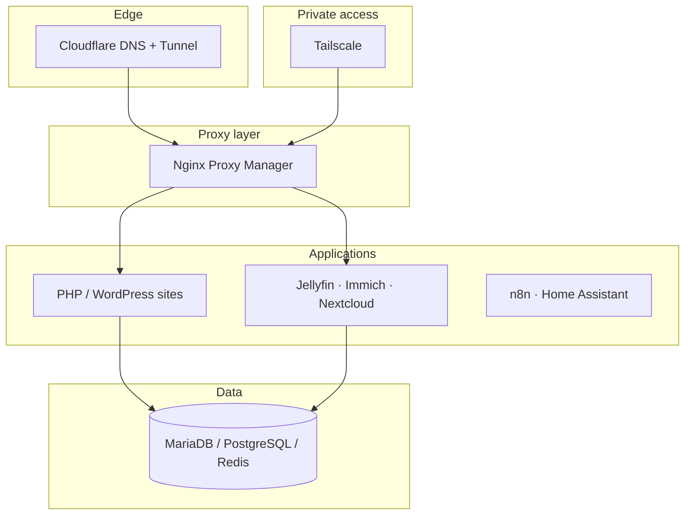

# Homelab showcase

Public, recruiter-friendly overview of my **self-hosted infrastructure** — how I design, deploy and operate real services at home.

> No IPs, tokens, firewall rules or internal ports. Architecture only.

**Full narrative & interactive map:** [portfolio.odev.es/lab](https://portfolio.odev.es/lab)

---

## What this demonstrates

| Skill area | Evidence |
|------------|----------|
| **DevOps / platform** | Docker Compose, reverse proxy, TLS, tunneling |
| **Web ops** | Multi-site PHP/WordPress hosting, redirects, clean URLs |
| **Reliability** | Health checks, monitoring, Telegram ops bot |
| **Security mindset** | Private admin surfaces, no raw exposure of critical services |
| **Automation** | n8n workflows, AI-assisted development (Cursor) |

---

## Architecture (high level)

---

## Public services

| Domain | Type |
|--------|------|
| [odev.es](https://odev.es) | Web studio site (WordPress, custom theme) |
| [odev.es/oscar](https://odev.es/oscar) | Link page (Next.js) |
| [portfolio.odev.es](https://portfolio.odev.es) | Personal portfolio (PHP) |
| [cercar.es](https://cercar.es) | Web app (TypeScript, PostgreSQL) |
| [dunia-lobera.odev.es](https://dunia-lobera.odev.es) | Client website (WordPress) |
| [nemoland.odev.es](https://nemoland.odev.es) | Community / games hub |
| [jellyfin.odev.es](https://jellyfin.odev.es) | Media server |

Each web runs in its own containers; path-based routing on odev.es (WordPress site + Next.js link page) is done in the reverse proxy.

Internal services (Immich, Nextcloud, Portainer, etc.) stay off the public internet.

---

## Operations model

| Tool | Role |
|------|------|
| **Odev Hub** | Dashboard · links · health · business CRM |
| **OdevDoctor** | Daily ops via Telegram |
| **Uptime Kuma / Beszel** | Monitoring |
| **Portainer** | Emergency Docker UI only |

---

## Stack

- **Host:** Ubuntu LTS · Docker · Docker Compose
- **Proxy:** Nginx Proxy Manager
- **Edge:** Cloudflare Tunnel
- **Remote:** Tailscale
- **Languages:** PHP, JavaScript, TypeScript, Python
- **Data:** MariaDB, PostgreSQL, Redis

---

## Author

**Oscar Carreras Yagüe** — [Portfolio](https://portfolio.odev.es) · [LinkedIn](https://www.linkedin.com/in/oscarcarrerasyague) · [GitHub @Oscar-Odev](https://github.com/Oscar-Odev)
